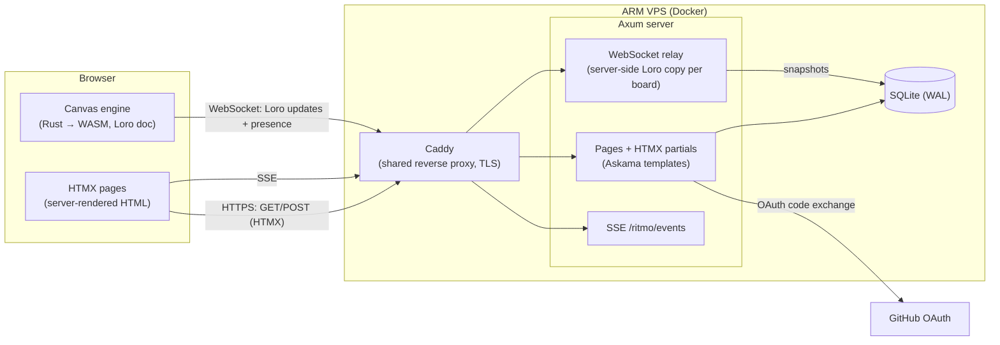

# Vanguarda

[](https://github.com/murandido/vanguarda-meeting/actions/workflows/ci.yml)
[](LICENSE)

A small, self-hosted dashboard for two friends' weekly alignment meeting.
It has two parts:

- **Cartazes**: a collaborative infinite whiteboard in the style of FigJam,
  where both people edit the same board in real time.
- **Ritmo**: a weekly Kanban board. Each person commits to a set of tasks at
  the meeting, checks in daily from their phone, and sees the partner's progress
  live.

There are exactly two users, so the project optimizes for low running cost,
simple operations and a fast, pleasant UI rather than scale. The UI is in
Portuguese; code and documentation are in English.

## Features

| Area | Feature | Status |
| --- | --- | --- |
| Cartazes | Real-time board sync between browsers (Loro CRDT over WebSocket) | ✅ Shipped |
| Cartazes | Live cursors of the other participant (presence channel) | ✅ Shipped |
| Cartazes | Board persistence in SQLite, restored on reconnect | ✅ Shipped |
| Cartazes | Infinite canvas: pan, zoom, viewport culling, 60 fps with 1,000 objects | ✅ Shipped |
| Cartazes | Multiple boards (create, rename, archive) and a hardened WebSocket (Origin check, size limits, validated imports, batched saves, keep-alive) | ✅ Shipped |
| Cartazes | Sticky notes with text, colors and resizing; stickers you can move, scale and rotate | ✅ Shipped |
| Cartazes | Per-user undo and redo | 🚧 In progress ([#21](https://github.com/murandido/vanguarda-meeting/pull/21)) |
| Cartazes | Arrows and connectors | 🚧 In progress |
| Ritmo | Weekly board per person with To do / Doing / Done columns and personal projects | ✅ Shipped |
| Ritmo | Weekly commitment ("prometido") frozen at the meeting, with done/total score | ✅ Shipped |
| Ritmo | Mobile daily check-in and a shared "today" feed | ✅ Shipped |
| Ritmo | Live updates through Server-Sent Events | ✅ Shipped |
| Ritmo | Check-in streaks | 🚧 In progress |
| Platform | Invite-only login with GitHub OAuth | ✅ Shipped |
| Platform | Continuous deployment to an ARM VPS with health check and automatic rollback | ✅ Shipped |
| Platform | Daily SQLite backups with a tested restore procedure | ✅ Shipped |
| Platform | Security hardening: CSP and security headers, `__Host-` cookies, Origin checks on writes, account binding, session revocation, read-only container | 🚧 In progress ([#17](https://github.com/murandido/vanguarda-meeting/pull/17)) |

## Architecture



- **Ritmo** is server-authoritative: forms post through HTMX, the server
  validates and stores the change, and an SSE event tells every open page to
  re-fetch the board fragment.
- **Cartazes** is local-first: the canvas engine applies edits to a local Loro
  document and exchanges binary updates over a WebSocket. The server keeps its
  own copy of each board, relays updates to the other participant and persists
  snapshots.

See [docs/architecture.md](docs/architecture.md) for the data flows, auth and
security model, and [docs/adr/](docs/adr/) for the decisions behind them.

## Tech stack

| Component | Choice | Why |
| --- | --- | --- |
| Language | Rust (2024 edition) everywhere | One language and type system from the database to the canvas ([ADR 0001](docs/adr/0001-rust-end-to-end.md)) |
| HTTP server | [Axum](https://github.com/tokio-rs/axum) on Tokio | Small, composable, first-class WebSocket and SSE support |
| Pages | [HTMX](https://htmx.org) + [Askama](https://github.com/askama-rs/askama) templates | Server-rendered HTML with compile-time-checked templates, no SPA build ([ADR 0003](docs/adr/0003-htmx-server-rendered-ui.md)) |
| Canvas engine | Rust compiled to WebAssembly (`wasm-bindgen`) | Shares the board model with the server; only the canvas needs client-side logic |
| Whiteboard sync | [Loro](https://loro.dev) CRDT | Concurrent edits converge without a central lock; offline edits merge on reconnect ([ADR 0002](docs/adr/0002-loro-crdt.md)) |
| Database | SQLite via [sqlx](https://github.com/launchbadge/sqlx) | Zero-ops, single file, queries checked at compile time ([ADR 0004](docs/adr/0004-sqlite.md)) |
| Auth | GitHub OAuth with an allow-list | Both users already have GitHub accounts; no passwords to store ([ADR 0005](docs/adr/0005-github-oauth-allowlist.md)) |
| Deployment | arm64 Docker image on GHCR, Caddy, SSH deploy | Cheap ARM VPS, automatic TLS, rollback on failed health check ([ADR 0006](docs/adr/0006-deployment.md)) |
| Tests | cargo-nextest, proptest, Playwright | Unit, integration, CRDT convergence properties and two-user browser flows ([ADR 0007](docs/adr/0007-quality-gates.md)) |

## Repository layout

| Path | Contents |
| --- | --- |
| `crates/shared` | Protocol types shared by server and client (presence messages, board id validation) |
| `crates/canvas` | Cartazes engine: board state in a Loro document; JS bridge in `src/wasm.rs` |
| `crates/server` | Axum app: pages, auth, WebSocket rooms, Ritmo, SQLite migrations, templates and static assets |
| `e2e/` | Playwright end-to-end tests (two users in separate browser contexts) |
| `deploy/` | Production compose file, deploy, backup and restore scripts, systemd backup timer and Caddy site template |
| `scripts/` | CI helpers (WASM size budget) |
| `.sqlx/` | Offline query metadata for sqlx (`cargo sqlx prepare --workspace`) |
| `docs/` | Architecture, operations runbook and ADRs |

## Getting started

Prerequisites:

- Rust stable with `rustfmt`, `clippy` and the `wasm32-unknown-unknown` target
- [`wasm-pack`](https://github.com/drager/wasm-pack)
- [`sqlx-cli`](https://github.com/launchbadge/sqlx/tree/main/sqlx-cli) (only when changing SQL)
- Node 22 (only for the end-to-end tests)
- [`lefthook`](https://github.com/evilmartians/lefthook) (optional, pre-commit hooks)

Build the canvas engine once, then run the server with the development login,
which skips GitHub:

```sh
wasm-pack build crates/canvas --target web --release
DEV_LOGIN=1 ALLOWED_GITHUB_USERS=ana,bia cargo run -p server
# http://127.0.0.1:3000
```

Use `http://127.0.0.1:3000`, not `localhost`: the WebSocket only accepts an
`Origin` equal to `PUBLIC_URL`. Open `/login` and sign in as `ana` in one window and as `bia` in a private
window. Then:

- create a board from **Cartazes → Novo quadro** on the home page and open it
  in both: double-click (or `N`) creates a sticky note, dragging moves it, and
  the other window follows along with a live cursor. Double-click or `Enter`
  edits a note's text; the floating bar changes its color and the corner handle
  resizes it. Pick a sticker under "Figurinhas" and click to place it; drag,
  scale with the corner handle and rotate with the top handle or `[` / `]`.
  `Delete` removes the selection. Space + drag, the middle button or a
  two-finger scroll pans; Ctrl/Cmd + wheel or a pinch zooms (10%–400%) around
  the pointer; `Shift+0` resets to 100% and `Shift+1` fits the content;
- open `/ritmo` in both: create a project, add tasks, confirm the week and do
  today's check-in at `/ritmo/checkin`; the other window updates on its own.

To use real GitHub login, create a GitHub OAuth App with the callback
`{PUBLIC_URL}/auth/github/callback` and set `GITHUB_CLIENT_ID` and
`GITHUB_CLIENT_SECRET` instead of `DEV_LOGIN`.

## Configuration

The server is configured through environment variables:

| Variable | Default | Purpose |
| --- | --- | --- |
| `ALLOWED_GITHUB_USERS` | required | Comma-separated GitHub logins allowed to sign in |
| `GITHUB_CLIENT_ID`, `GITHUB_CLIENT_SECRET` | none | GitHub OAuth App credentials; required unless `DEV_LOGIN` is on |
| `PUBLIC_URL` | `http://127.0.0.1:3000` | Public base URL: the OAuth callback is `{PUBLIC_URL}/auth/github/callback`, and it is the only `Origin` the WebSocket accepts |
| `COOKIE_SECURE` | `true` when `PUBLIC_URL` is https | Send the session cookie over HTTPS only |
| `DEV_LOGIN` | off | Enables `/auth/dev/{login}` for local development and E2E; refused unless `BIND` is a loopback address |
| `DATABASE_URL` | `sqlite://vanguarda.db` | SQLite database (created and migrated on start) |
| `BIND` | `127.0.0.1:3000` | Listen address |
| `STATIC_DIR`, `PKG_DIR` | repository folders | Static assets and `wasm-pack` output |
| `RUST_LOG` | `info,loro_internal=warn,server=debug` | Log filter (`tracing-subscriber` syntax) |

## Testing and quality gates

Every gate runs in CI and is required to merge into `main`, except the
informational benchmarks. [`ci.yml`](.github/workflows/ci.yml) compiles the
workspace once per heavy job (`rust` for QG-01..05 and QG-09, `web` for
QG-07/08) and reports each gate as its own status check; docs-only pull
requests skip compilation. QG-10 and QG-11 live in
[`pr-title.yml`](.github/workflows/pr-title.yml) and
[`bench.yml`](.github/workflows/bench.yml).

| Gate | Job | What it checks |
| --- | --- | --- |
| QG-01 | `fmt` | `cargo fmt --check` |
| QG-02 | `clippy` | Clippy with `pedantic`, warnings denied, native and `wasm32` |
| QG-03/04 | `test` | Unit and integration tests (nextest), doctests, and a proptest that CRDT replicas converge regardless of update order |
| QG-05 | `sqlx` | Offline query metadata in `.sqlx/` matches the queries and migrations |
| QG-06 | `deny` | cargo-deny: advisories, licenses, banned crates, sources |
| QG-07 | `wasm` | Release WASM build stays within 10% of the gzip size budget |
| QG-08 | `e2e` | Playwright: two users on the same board and Ritmo page see each other's changes |
| QG-09 | `coverage` | Line coverage may not drop more than 0.1 pp below `main` |
| QG-10 | `pr-title` | PR title follows Conventional Commits (it becomes the squash commit) |
| QG-11 | `bench` | Benchmarks build on `main` (informational, never blocks) |

Locally:

```sh
cargo fmt --all --check
cargo clippy --workspace --all-targets -- -D warnings
cargo test --workspace
cargo deny check
cd e2e && npm ci && npx playwright install chromium && npx playwright test
```

Changed a SQL query? Run `cargo sqlx prepare --workspace` and commit `.sqlx/`.
Viewport culling benchmarks: `cargo bench -p canvas`.

## Deployment

Production runs as a single container on an ARM (aarch64) VPS behind a shared
Caddy reverse proxy that terminates TLS. Every push to `main` with a green CI
cross-compiles the server for arm64, publishes an image to GHCR and deploys it
over SSH; the deploy script waits for the container's health check and rolls
back to the previous image if it fails.

The one-time server setup, configuration files, inviting a user, backups and
restore are documented in [docs/operations.md](docs/operations.md).

## How this was built

Vanguarda is developed by [Murilo Cândido](https://github.com/murandido) with
AI pair-programming through [Claude Code](https://claude.com/claude-code). The
requirements, architecture decisions and reviews are his; much of the code and
documentation was drafted with the assistant. Every change, whoever drafted it,
goes through a pull request, the CI quality gates above and review before it
reaches `main`.

## License

[MIT](LICENSE) © 2026 Murilo Cândido
