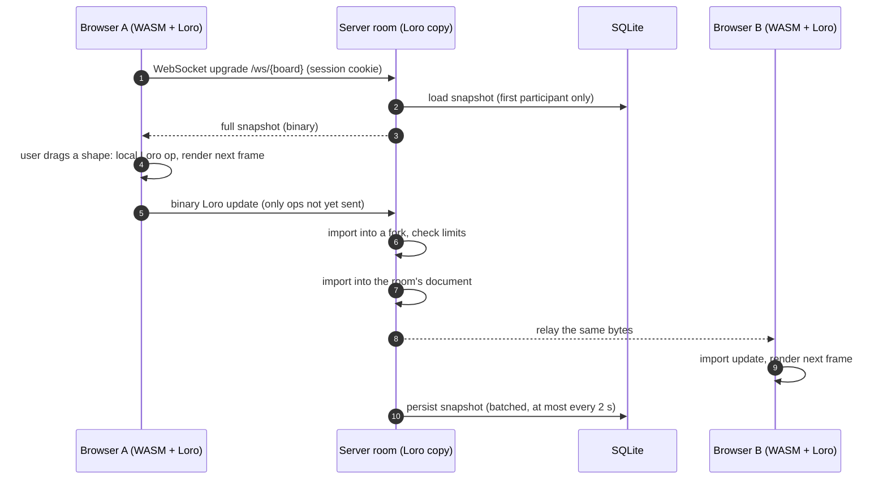
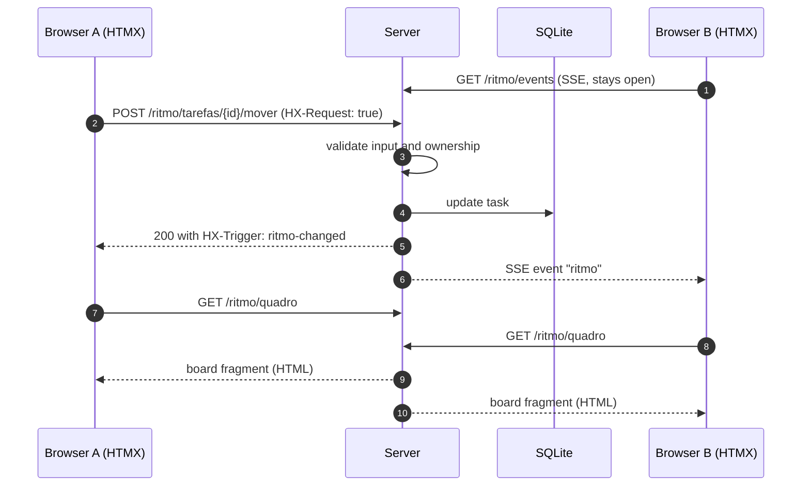

# Architecture

Vanguarda is a single Rust server (Axum) that serves two very different
features:

- **Ritmo** (weekly Kanban) is classic server-rendered CRUD. The server owns the
  data; the browser gets HTML.
- **Cartazes** (whiteboard) is local-first. Each browser holds a full copy of
  the board as a [Loro](https://loro.dev) CRDT document inside a WebAssembly
  module, and the server relays and persists updates.

The split is deliberate: a CRDT earns its complexity only where two people edit
the same free-form data concurrently. Everything else stays simple. The
decisions are recorded in [ADRs](adr/).

Items marked **(pending #N)** are implemented in an open pull request and are
not on `main` yet.

## Components

| Component | Location | Responsibility |
| --- | --- | --- |
| Server | `crates/server` | HTTP routes, auth middleware, HTMX pages (Askama), board list, WebSocket rooms, Ritmo, SSE, SQLite access and migrations; process startup and graceful shutdown in `startup.rs` |
| Canvas engine | `crates/canvas` | Board model (sticky notes, stickers) on top of a Loro document, camera (pan and zoom), viewport culling and hit testing; compiled natively for the server and to WASM for the browser |
| Shared protocol | `crates/shared` | Presence message types and board id validation used by both sides |
| Board client | `crates/server/static/board.js` | Thin JS glue: input events, the `<canvas>` render loop and the WebSocket |
| Ritmo client | `crates/server/static/ritmo.js` | Opens the SSE stream and asks HTMX to refresh the board fragment |

## Cartazes: editing a board

1. **Local edit.** Input handlers in `board.js` call into the WASM `Board`,
   which writes to the local Loro document. The UI never waits for the network.
2. **Send.** `takePendingUpdate()` exports only the operations since the last
   send (tracked with a Loro version vector) and `board.js` sends them as one
   binary WebSocket frame.
3. **Validate.** The server first imports the update into a `fork()` of the
   room's document and checks limits (at most 5,000 shapes, shape ids of at
   most 64 bytes, snapshots of at most 2 MiB). An update that fails to import or
   breaks a limit is dropped without being relayed, so one bad client cannot
   poison the shared state. Otherwise it is imported into the room's document.
4. **Broadcast.** Accepted bytes go to the other participants of the room
   through a Tokio broadcast channel, unchanged. A client that falls too far
   behind the channel is disconnected; it reconnects and receives a fresh
   snapshot. Because CRDT imports are idempotent, receiving an update twice is
   harmless.
5. **Persist.** An update only marks the room dirty; a per-room task writes a
   snapshot to SQLite at most every 2 seconds, plus a final save when the last
   participant leaves and on graceful shutdown (SIGTERM or Ctrl+C, which also
   closes sockets with code 1012). Each save also bumps the board's
   `updated_at`, shown in the board list.

On (re)connection the client receives the server's full snapshot and merges it
with its own document, so edits made while disconnected are not lost. The
server subscribes the new client to the broadcast channel *before* taking the
snapshot, so no update can fall into the gap between the two.

A room exists only while someone is connected: the first participant loads the
board from SQLite, and the room is dropped from memory when the last one
leaves. Joining and leaving happen under the room-map lock and rooms count
their participants explicitly, so there are never two rooms for the same board.
Boards themselves are rows in a `boards` table (title, creator, archive flag):
only boards created from the home page open, an unknown id answers 404 and an
archived one 410, for both the page and the WebSocket.

### Presence

Cursor positions use **text** frames carrying JSON (`PresenceMsg` in
`crates/shared`), on the same WebSocket but separate from the document:

- they are ephemeral and never stored or merged into the CRDT;
- the client throttles them to about 30 per second;
- the server overwrites the `user` field with the login from the session, so a
  client cannot impersonate someone else;
- when a connection closes, the server broadcasts a `leave` message.

Cursors are in board (world) coordinates, so participants with different pan
and zoom see each other's cursors in the right place. The camera (pan and
zoom) is local to each participant and never enters the shared document.

### Connection health

The server pings every 30 seconds and closes a connection after 60 seconds
without any traffic from the client. The client reconnects after one second.
Frames and messages larger than 256 KiB close the sender's connection only.

## Ritmo: request and SSE flow

- The server is the single source of truth. Every mutation is validated on the
  server, and users can only change their own tasks, projects and check-ins
  (403 otherwise), while both can read everything.
- Mutations require the `HX-Request: true` header, which a cross-site HTML form
  cannot set.
- After a successful write, the server answers with an `HX-Trigger` header, so
  the acting page re-fetches the board fragment, and sends a payload-less event
  on an in-process broadcast channel. Each open `/ritmo/events` stream forwards
  it, and `ritmo.js` triggers the same refresh on the other pages. Changes that
  affect forms outside the board (projects, settings) use `HX-Refresh` instead. A reconnecting
  stream also refreshes, so a missed event costs at most one extra fetch.
- "Now" comes from an injectable clock in the application state, which lets
  the integration tests pin the week boundary (the week turns over at the end of
  the meeting day, Tuesday by default).

## Authentication and sessions

- **Login.** `/auth/github` redirects to GitHub with a random `state` stored in
  a short-lived (10 minutes) `HttpOnly` cookie. The callback checks the
  `state`, exchanges the code, reads the user's profile and accepts the login
  only if it is in `ALLOWED_GITHUB_USERS`. No OAuth scopes are requested.
- **Session.** A 256-bit random token in an `HttpOnly`, `SameSite=Lax` cookie
  (`Secure` over HTTPS), stored in the `sessions` table with a 30-day expiry.
  Logout deletes the row.
- **Middleware.** `require_user` guards every route except `/login`, `/auth/*`,
  `/health` and `/static/*`. Pages redirect to `/login`; the WebSocket and SSE
  endpoints answer 401.
- **Development login.** `DEV_LOGIN=1` enables `/auth/dev/{login}` for invited
  logins only, and the server refuses to start with it unless it listens on a
  loopback address. The end-to-end tests use it.

Hardening:

- the first GitHub account id seen for a login is pinned, so a renamed or
  re-registered GitHub username cannot take over an invitation
  (`login:id` entries in `ALLOWED_GITHUB_USERS` make the id explicit);
- the allow-list is checked on every request, and a background task purges
  revoked and expired sessions;
- cookies use the `__Host-` prefix over HTTPS;
- outgoing requests to GitHub have connect and total timeouts.

## Security model

The threat model is small: two known users, one public URL, no user-generated
HTML. The main risks are someone who is not invited getting in, cross-site
requests riding on a valid session, and a misbehaving client degrading the
shared board.

| Control | Status |
| --- | --- |
| Invite-only GitHub login, random session tokens, `HttpOnly` cookies | On `main` |
| OAuth `state` check against CSRF on login | On `main` |
| `HX-Request` required on Ritmo mutations | On `main` |
| Ownership checks on every Ritmo write | On `main` |
| Presence identity taken from the session, not the client | On `main` |
| Askama templates escape HTML by default | On `main` |
| Queries checked at compile time by sqlx; no string-built SQL | On `main` |
| Container runs as an unprivileged user (uid 10001), memory-limited | On `main` |
| WebSocket upgrade requires `Origin` equal to `PUBLIC_URL` (cross-site WebSocket hijacking) | On `main` |
| WebSocket frame/message size limits; updates validated on a fork before they are applied | On `main` |
| `Origin` check on every non-safe method | Shipped (#17) |
| Content Security Policy without inline scripts or `eval` (only `'wasm-unsafe-eval'`), plus `Referrer-Policy`, `Permissions-Policy`, `X-Frame-Options`, `X-Content-Type-Options` | Shipped (#17) |
| `__Host-` cookies, account-id binding, per-request allow-list check | Shipped (#17) |
| Read-only root filesystem, all capabilities dropped, `no-new-privileges`, PID limit, base image pinned by digest | Shipped (#17) |
| HSTS and `nosniff` at the reverse proxy | On `main` |
| Board create/rename/archive posts require `HX-Request` | On `main` |

`SameSite=Lax` alone is not enough here: sibling subdomains of the same
registrable domain count as same-site, which is why the explicit `Origin`
checks matter.

Dependencies are checked by cargo-deny in CI (RustSec advisories, licenses,
sources), and GitHub Actions are pinned by commit SHA and updated by
Dependabot.

## Performance

- **Target:** 60 fps while panning, zooming and dragging with 1,000 objects on
  the board.
- **Rendering:** `board.js` draws on a `<canvas>` from a single
  `requestAnimationFrame` loop. Geometry crosses the JS/WASM boundary once per
  frame as a flat `Float64Array` instead of one JS object per shape.
- **Culling and caching:** the engine caches shape geometry and
  invalidates it only when the Loro document's frontiers change, and returns
  only the shapes inside the viewport. Measured locally: culling 1,000 shapes
  takes about 3 µs; the end-to-end test measures a median frame time of
  16.7 ms with 1,000 objects.
- **Network:** updates are incremental Loro deltas; cursors are throttled; the
  server relays bytes without re-encoding them.
- **WASM size:** the canvas crate is built with `opt-level = "z"`, LTO and a
  single codegen unit, and CI fails if the gzipped module grows more than 10%
  over the recorded budget.
- **Server:** SQLite runs in WAL mode so reads (including backups) do not block
  writes; snapshot writes are batched per room.
